# Diagrammes du projet

[Architecture globale en image](architecture-globale.png) · [Cas d’utilisation](cas-utilisation.svg)

Les schémas ci-dessous sont une conception proposée ; ils ne prétendent pas représenter un métier déjà réalisé. Config Server, Eureka et Gateway sont vérifiés localement.

## Architecture globale

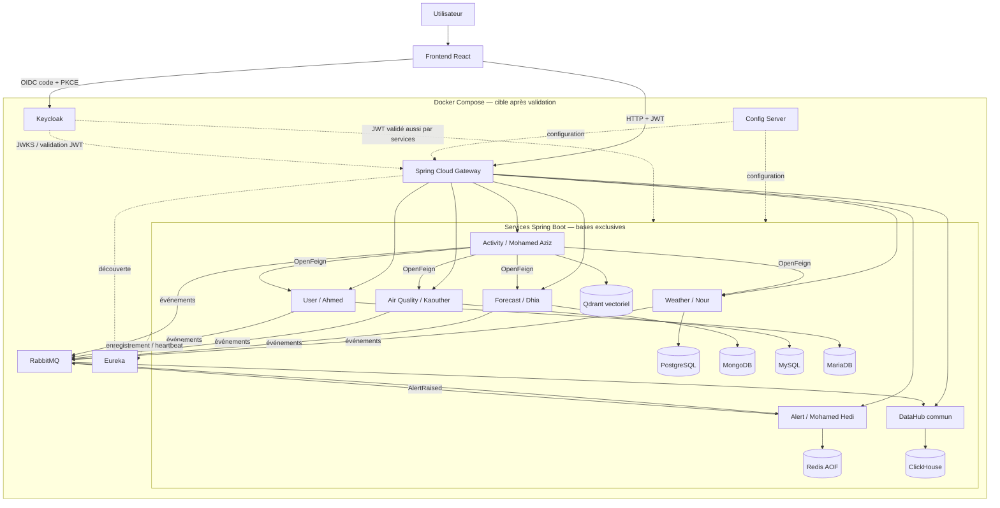

## Activity service classes

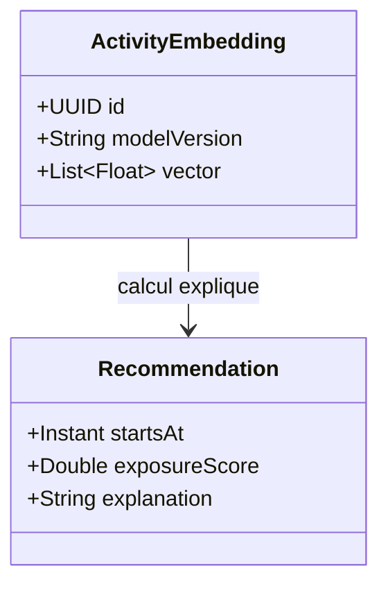

## Air quality service classes

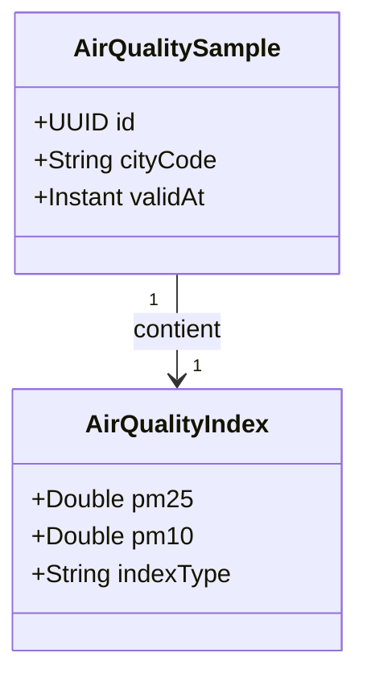

## Alert service classes

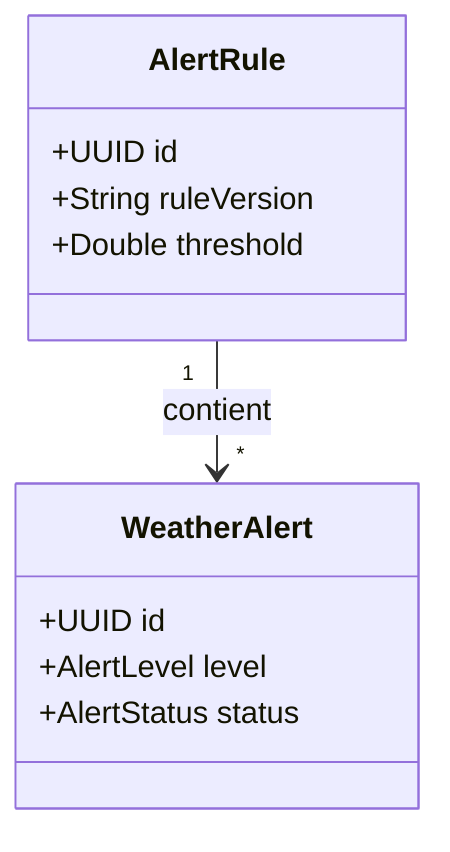

## Datahub service classes

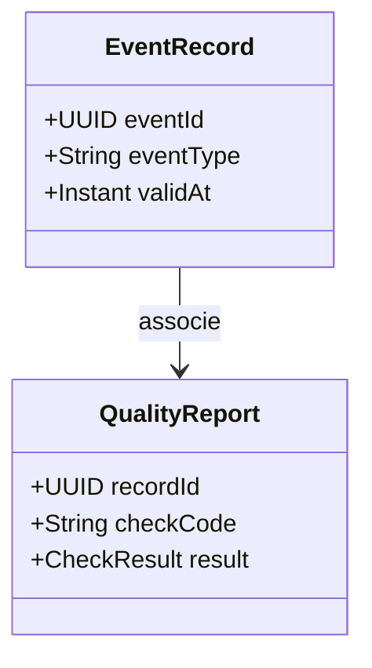

## Forecast service classes

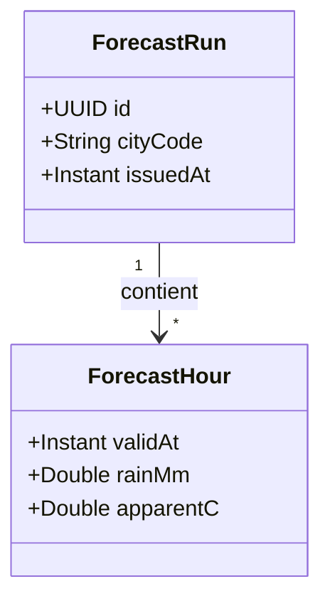

## User service classes

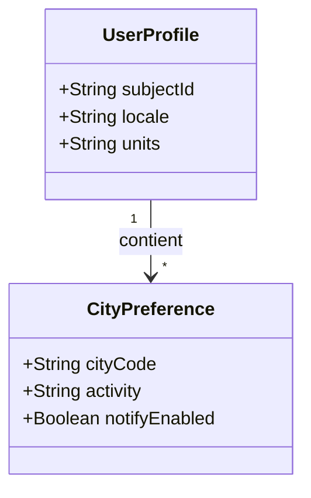

## Weather service classes

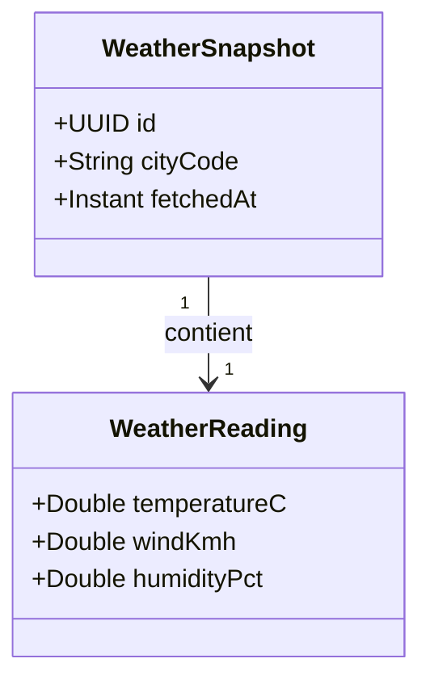

## Sequence recommandation

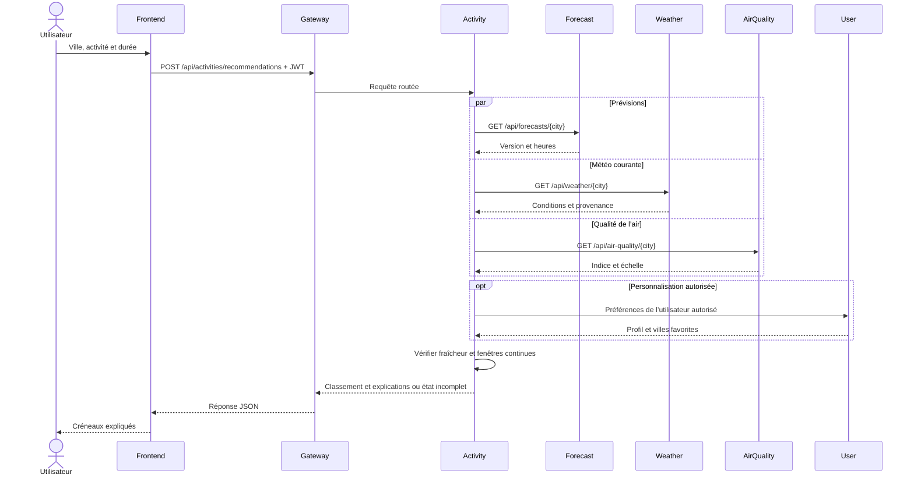

## Sequence vector search

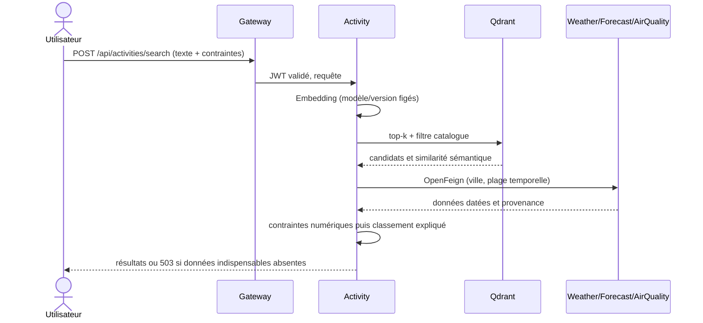

## Sequence evenements

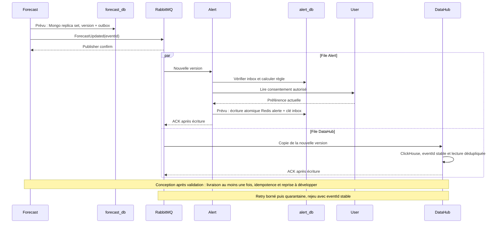

